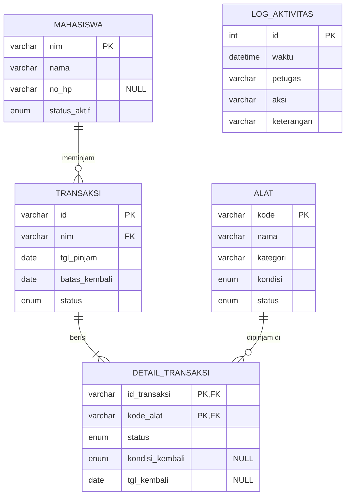
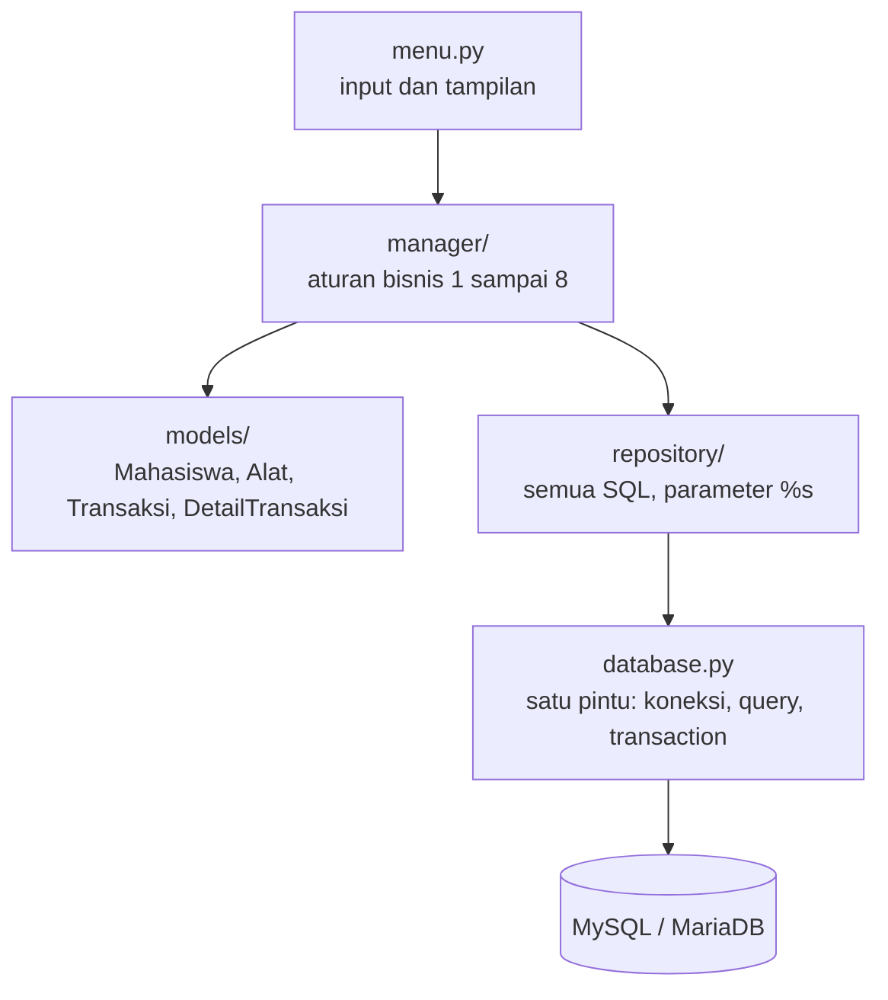

# Sistem Pengelolaan Peminjaman Peralatan Laboratorium

Proyek II Praktikum Pemrograman Dasar, Semester 3 Pendidikan Teknik Informatika dan Komputer (PTIK), Universitas Sebelas Maret.
Aplikasi berbasis Python (OOP) dengan penyimpanan permanen di **database MySQL** (MySQL/MariaDB XAMPP untuk
pengembangan, MySQL online untuk data bersama). Versi sebelumnya menyimpan data di text file `.txt`; file lama itu
sekarang hanya arsip di `data/` dan dipindahkan sekali ke database lewat `scripts/migrate_txt.py`.

Repository: https://github.com/ariftronic/Kelompok2PraktikumPemrogramanDasarGroupProject3

Repository versi `.txt` sebelumnya: https://github.com/ariftronic/Kelompok2PraktikumPemrogramanDasarGroupProject2

## Anggota Kelompok (Kelompok 2)

| Nama | NIM | Akun GitHub | Peran |
|---|---|---|---|
| Muhammad Nur Arif | K3525034 | ariftronic | Koordinator, koneksi database dan konfigurasi, menu utama, log aktivitas |
| Fatimah Az Zahra (Rara) | K3525006 | fatimahzahrara | Data mahasiswa dan alat |
| Faris Rafiuddin Hannan | K3525058 | farisrafiuddin82-oss | Peminjaman (transaksi) dan migrasi |
| Niken Syafira Zulfarida | K3525038 | Niken5yafiraZulfarida | Pengembalian, laporan, dan QA |

## Deskripsi Sistem

Laboratorium menyediakan peralatan yang dapat dipinjam mahasiswa. Aplikasi ini mencatat mahasiswa, peralatan,
transaksi peminjaman (satu transaksi boleh berisi beberapa alat), pengembalian alat (boleh sebagian) beserta
kondisinya. Semua data disimpan di database, sehingga data yang dimasukkan satu anggota langsung terlihat oleh anggota
lain yang memakai database yang sama.

Aturan bisnis yang diterapkan:

1. Alat yang tidak tersedia tidak dapat dipinjam.
2. Seorang mahasiswa maksimal memiliki dua transaksi aktif.
3. Satu transaksi dapat berisi beberapa alat (satu baris `detail_transaksi` per alat).
4. Pengembalian boleh sebagian; transaksi tetap aktif (`sebagian dikembalikan`) sampai semua alat kembali.
5. Alat yang kembali dalam kondisi `rusak ringan` atau `rusak berat` tidak kembali menjadi tersedia.
6. Mahasiswa atau alat yang masih ada di transaksi aktif tidak dapat dihapus. Yang tercatat di riwayat transaksi juga
   tidak dapat dihapus agar rujukan transaksi tetap utuh (Aturan 8).
7. Data di program dan di database selalu sama: operasi yang menyentuh beberapa tabel dijalankan dalam satu
   transaction (semua `COMMIT` atau semua `ROLLBACK`), dan operasi yang ditolak tidak mengubah database.
8. NIM dan kode alat di transaksi harus ada di tabel `mahasiswa` dan `alat` (foreign key); NIM, kode alat, dan ID
   transaksi tidak ganda (primary key).

Tambahan: batas pengembalian 7 hari sejak tanggal pinjam; status aktif peminjaman mahasiswa diatur otomatis
(`aktif` selama mahasiswa memiliki transaksi aktif); keterlambatan pengembalian ditampilkan dan dicatat di log.

## Menu Program

| No | Menu | Keterangan |
|---|---|---|
| 1 | Kelola data mahasiswa | tambah, edit, hapus, cari (NIM/nama), tampilkan semua |
| 2 | Kelola data alat | tambah, edit, hapus, cari (kode/sebagian nama/kategori), tampilkan semua |
| 3 | Buat transaksi peminjaman | satu NIM, satu atau beberapa kode alat dipisahkan koma |
| 4 | Tampilkan transaksi | semua transaksi beserta status setiap alat |
| 5 | Proses pengembalian alat | satu atau beberapa alat, kondisi dipilih per alat |
| 6 | Cari transaksi berdasarkan mahasiswa | transaksi aktif milik NIM |
| 7, 8, 9 | Tampilkan alat tersedia, sedang dipinjam, rusak | |
| 10 | Tampilkan riwayat peminjaman mahasiswa | semua transaksi milik NIM, termasuk yang selesai |
| 11 | Lihat log aktivitas | 20 baris terakhir tabel `log_aktivitas` (Tantangan D) |
| 12 | Statistik peminjaman | Tantangan B |
| 13 | Ekspor laporan ke text file | Tantangan F |
| 14 | Tampilkan transaksi terlambat | Tantangan G |
| 0 | Keluar | menutup koneksi database (semua perubahan sudah di-commit saat operasinya selesai) |

Daftar yang panjang diambil per 20 baris dengan `LIMIT`/`OFFSET` (Enter untuk halaman berikutnya, `q` untuk berhenti).
Tabel kosong ditampilkan sebagai `(data kosong)`.

## Setup Database dan `.env`

Kebutuhan: Python 3.8 atau lebih baru dan salah satu server berikut.

```bash
pip install -r requirements.txt
```

Library yang dipakai hanya `PyMySQL` (driver MySQL, tanpa ORM) dan `python-dotenv` (membaca `.env`).

### 1. Buat file `.env`

Salin `.env.example` menjadi `.env` di folder proyek, lalu isi sesuai server yang dipakai. **File `.env` tidak boleh
di-commit** (sudah ada di `.gitignore`); yang ada di repository hanya `.env.example` tanpa password.

| Variabel | Arti | XAMPP bawaan |
|---|---|---|
| `DB_HOST` | alamat server | `127.0.0.1` |
| `DB_PORT` | port server | `3306` |
| `DB_USER`, `DB_PASSWORD` | akun database | `root`, kosong |
| `DB_NAME` | nama database | `peminjaman_lab` |
| `DB_SSL_CA` | path file sertifikat CA bila server mewajibkan SSL | kosong |
| `NAMA_PETUGAS` | nama yang dicatat di log aktivitas | bebas, misalnya nama anggota |

Variabel lingkungan sistem dengan nama yang sama mengalahkan isi `.env` (dipakai oleh tes).

### 2a. MySQL lokal (XAMPP)

1. Buka XAMPP Control Panel, tekan **Start** pada MySQL.
2. Isi `.env` seperti kolom "XAMPP bawaan" di atas. Bila port 3306 bentrok, ubah port di `my.ini` XAMPP dan `DB_PORT`.
3. Jalankan `python main.py`. Database `peminjaman_lab` dan semua tabel dibuat otomatis bila belum ada
   (`CREATE DATABASE` lalu `CREATE TABLE IF NOT EXISTS` dari `database/schema.sql`).

Cara manual lewat phpMyAdmin (bila ingin): buat database `peminjaman_lab`, lalu tab **Import** untuk
`database/schema.sql` kemudian `database/seed.sql`.

### 2b. MySQL online (untuk data bersama dan demo Skenario 8)

Kelompok memakai layanan MySQL online gratis (misalnya Aiven for MySQL). Satu anggota membuat layanannya, lalu
membagikan isi `.env` dan file sertifikatnya **lewat pesan pribadi, bukan lewat repository**.

1. Buat layanan MySQL paket gratis, tunggu sampai statusnya berjalan.
2. Dari halaman ringkasan layanan, salin host, port, user, dan password ke `.env`.
3. Unduh sertifikat CA (`ca.pem`), simpan di folder proyek, lalu isi `DB_SSL_CA=ca.pem`. Pola `*.pem` sudah ada di
   `.gitignore`.
4. Isi `DB_NAME=peminjaman_lab`; database dan tabel dibuat otomatis saat program pertama dijalankan. Bila akun tidak
   punya hak membuat database, buat database tersebut dari console layanan.
5. Layanan gratis dapat berhenti sendiri bila lama tidak dipakai. Nyalakan kembali dari console sebelum demo.

Kode program sama untuk kedua server; yang berbeda hanya isi `.env`.

### 3. Isi data

Pilih salah satu:

```bash
python scripts/migrate_txt.py
```

memindahkan data lama dari `data/*.txt` ke database (lihat bagian Migrasi).

```bash
python scripts/migrate_txt.py --sumber data_sampel --kosongkan
```

mengisi data contoh (5 mahasiswa, 10 alat, 3 transaksi) dan menghapus isi tabel lebih dulu. Isinya sama dengan
`database/seed.sql`, yang juga dapat di-import lewat phpMyAdmin.

## Cara Menjalankan

```bash
python main.py
```

Bila koneksi gagal (MySQL XAMPP belum menyala, internet terputus, password salah), program menampilkan pesan
`[!] Koneksi database gagal: ...` beserta penyebabnya lalu berhenti dengan rapi tanpa traceback. Kesalahan database
saat program berjalan ditampilkan sebagai `[!] [ERROR DATABASE] ...`, dan data tidak berubah.

### Pengujian

```bash
python -m unittest -v
```

Tes tanpa database (validasi, model, konfigurasi, terjemahan error, bantuan SQL, FileManager) selalu dijalankan. Tes
yang memakai database berjalan di database terpisah bernama `<DB_NAME>_test` (misalnya `peminjaman_lab_test`, dibuat
otomatis dan dikosongkan di setiap tes), sehingga database utama tidak tersentuh. Bila server tidak dapat dihubungi,
tes database dilewati (`skipped`). Nama database tes dapat diganti dengan variabel `TEST_DB_NAME` (harus berakhiran
`_test`).

```bash
python tests/skenario_wajib.py
```

menjalankan 10 skenario wajib lewat `main.py` sungguhan di database `<DB_NAME>_skenario` (dihapus dan dibuat ulang)
dan menulis hasilnya ke `docs/bukti_eksekusi_skenario.md`.

## Skema Tabel dan Relasi

Skema lengkap ada di `database/schema.sql`; data contoh di `database/seed.sql`. Semua tabel memakai InnoDB dan
`utf8mb4`.



| Tabel | Kolom | Constraint dan index |
|---|---|---|
| `mahasiswa` | `nim` VARCHAR(20), `nama` VARCHAR(60), `no_hp` VARCHAR(16) NULL, `status_aktif` ENUM(`aktif`, `tidak aktif`) | PK `nim` |
| `alat` | `kode` VARCHAR(15), `nama` VARCHAR(60), `kategori` VARCHAR(40), `kondisi` ENUM(`baik`, `rusak ringan`, `rusak berat`), `status` ENUM(`tersedia`, `dipinjam`, `tidak tersedia`) | PK `kode`; index `status`, `kategori` |
| `transaksi` | `id` VARCHAR(20), `nim` VARCHAR(20), `tgl_pinjam` DATE, `batas_kembali` DATE, `status` ENUM(`dipinjam`, `sebagian dikembalikan`, `selesai`) | PK `id`; FK `nim` ke `mahasiswa`; CHECK `batas_kembali >= tgl_pinjam`; index (`nim`, `status`) |
| `detail_transaksi` | `id_transaksi`, `kode_alat`, `status` ENUM(`dipinjam`, `dikembalikan`), `kondisi_kembali` ENUM NULL, `tgl_kembali` DATE NULL | PK (`id_transaksi`, `kode_alat`); FK ke `transaksi` dan `alat`; CHECK: `dipinjam` berarti kondisi dan tanggal kembali `NULL`, `dikembalikan` berarti keduanya terisi; index (`kode_alat`, `status`) |
| `log_aktivitas` | `id` INT AUTO_INCREMENT, `waktu` DATETIME, `petugas`, `aksi`, `keterangan` | PK `id`; index `waktu` (Tantangan D) |

Semua kolom selain yang ditandai `NULL` bersifat `NOT NULL`. Foreign key memakai perilaku bawaan `RESTRICT`, jadi
induk yang masih dirujuk tidak dapat dihapus; program memeriksanya lebih dulu agar pesannya jelas. Panjang kolom
mengikuti batas validasi di `app/validasi.py`. Sesi koneksi memakai `sql_mode` ketat, sehingga nilai ENUM yang salah
atau teks yang terlalu panjang ditolak, bukan dipotong diam-diam.

Kapan program membaca dan menulis database:

- **dibaca** setiap kali data ditampilkan atau diperiksa, langsung dengan query terfilter (`WHERE`, `JOIN`, `COUNT`,
  `LIMIT`), bukan memuat seluruh tabel di awal. Hasil query berbentuk `dict` (`DictCursor`) lalu diubah menjadi objek
  `Mahasiswa`, `Alat`, `Transaksi`, dan `DetailTransaksi`;
- **ditulis dan di-commit** segera setelah setiap operasi berhasil. Peminjaman dan pengembalian dijalankan dalam satu
  transaction; alat dan mahasiswa yang terlibat dikunci dengan `SELECT ... FOR UPDATE` agar dua petugas tidak dapat
  meminjamkan alat yang sama pada saat bersamaan;
- semua query memakai placeholder `%s` (parameterized query), sehingga input seperti `O'Neil` tersimpan apa adanya.

## Migrasi dari `.txt`

`scripts/migrate_txt.py` dijalankan sekali untuk memindahkan data lama:

1. membuat tabel bila belum ada, lalu menolak berjalan bila tabel sudah berisi data (kecuali dengan `--kosongkan`);
2. membaca dan memvalidasi setiap baris `data/*.txt` dengan model yang sama dengan program; baris yang salah, ganda,
   atau rujukannya tidak ada dilewati dengan `[PERINGATAN]`;
3. menyelaraskan status turunan (status transaksi, alat, dan mahasiswa) dengan detail transaksi;
4. `INSERT` berurutan induk lalu anak (`mahasiswa`, `alat`, `transaksi`, `detail_transaksi`) dalam satu transaction;
5. membandingkan jumlah baris tabel dengan jumlah baris valid; bila berbeda semuanya di-`ROLLBACK`.

Setelah migrasi, program tidak lagi membaca `data/`. Folder itu tetap disimpan sebagai arsip.

## Struktur Program

```
main.py                         titik masuk, hanya memanggil menu utama
requirements.txt                PyMySQL, python-dotenv
.env.example                    contoh konfigurasi tanpa password
app/
  config.py                     baca_konfigurasi(): membaca .env
  database.py                   Database: satu-satunya tempat connect/execute/commit/rollback; DatabaseError
  repository/
    repo_dasar.py               RepoDasar: bantuan LIKE, LIMIT/OFFSET, FOR UPDATE
    repo_mahasiswa.py           RepoMahasiswa: SQL tabel mahasiswa
    repo_alat.py                RepoAlat: SQL tabel alat
    repo_transaksi.py           RepoTransaksi: SQL tabel transaksi dan detail_transaksi
    repo_laporan.py             RepoLaporan: query statistik (GROUP BY) dan keterlambatan
    repo_log.py                 RepoLog: SQL tabel log_aktivitas
  manager/
    manager_dasar.py            ManagerDasar: pola bersama manager data
    manager_mahasiswa.py        ManagerMahasiswa (turunan ManagerDasar)
    manager_alat.py             ManagerAlat (turunan ManagerDasar)
    manager_transaksi.py        ManagerTransaksi: peminjaman dalam satu transaction
    manager_pengembalian.py     ManagerPengembalian: pengembalian dan keterlambatan
    manager_laporan.py          ManagerLaporan: statistik, keterlambatan, ekspor laporan
  models/                       Mahasiswa, Alat, Transaksi, DetailTransaksi (dari_dict untuk hasil query)
  logger.py                     Logger: mencatat aktivitas ke tabel log_aktivitas
  file_manager.py               FileManager: menulis laporan .txt dan membaca .txt lama untuk migrasi
  validasi.py                   fungsi validasi input
  konstanta.py                  string status/kondisi, aturan bisnis, lokasi file
  menu.py                       AplikasiPeminjaman: tampilan menu dan input (tanpa SQL dan tanpa aturan bisnis)
database/
  schema.sql                    CREATE TABLE
  seed.sql                      data contoh
scripts/migrate_txt.py          migrasi data .txt lama ke database
data/                           arsip .txt lama (tidak dipakai program lagi)
data_sampel/                    data contoh dalam format .txt lama
laporan/                        hasil ekspor laporan (dibuat otomatis, tidak ikut di-commit)
docs/                           UML, ERD, keputusan desain, pengujian, review, refleksi
tests/                          pengujian otomatis (unittest) dan skrip 10 skenario wajib
```

Lapisan program:



Struktur class lengkap ada di `docs/final/UML_Final_Implementasi_Kelompok2.png` (sumber draw.io:
`UML_Final_Implementasi_Kelompok2.drawio`) dan ERD di `docs/final/ERD_Final_Kelompok2.png`. Pembagian tanggung jawab
antarmodul dijelaskan di `docs/kontrak_antarmodul.md`.

### Laporan (Tantangan F)

Menu 13 menulis laporan ke folder `laporan/` dengan nama yang memuat tanggal, misalnya
`laporan_alat_dipinjam_2026-11-18.txt`, `laporan_alat_rusak_2026-11-18.txt`, `laporan_riwayat_M001_2026-11-18.txt`, dan
`laporan_statistik_2026-11-18.txt`. Isinya tabel teks rata kiri. Text file hanya dipakai untuk laporan, bukan sebagai
penyimpanan data.

## Tantangan yang Dipilih

- **A, Pencarian fleksibel:** alat dicari dari kode, sebagian nama, atau kategori dengan `LIKE`; setiap kata kunci
  harus cocok (`AND`), karakter `%` dan `_` dari input di-escape.
- **B, Statistik:** alat dan mahasiswa paling sering meminjam, jumlah transaksi per status (`GROUP BY`, `COUNT`).
- **D, Log aktivitas:** tabel `log_aktivitas` mencatat siapa (`NAMA_PETUGAS`), aksi apa, dan kapan.
- **F, Ekspor laporan:** alat dipinjam, alat rusak, riwayat mahasiswa, dan statistik ke `laporan/*.txt`.
- **G, Keterlambatan:** transaksi aktif yang melewati `batas_kembali` beserta jumlah hari terlambat (`DATEDIFF`).

## Pembagian Kontribusi

Tahap `.txt` (Proyek II versi pertama):

| Anggota | Kontribusi |
|---|---|
| Muhammad Nur Arif | Repository dan struktur folder, `konstanta.py`, `file_manager.py`, `logger.py`, `menu.py`, `main.py`, README, pengujian FileManager/Logger, Dokumen Keputusan Desain |
| Fatimah Az Zahra | `models/mahasiswa.py`, `models/alat.py`, `manager_mahasiswa.py`, `manager_alat.py`, `validasi.py`, UML final, data sampel |
| Faris Rafiuddin Hannan | `models/transaksi.py`, `manager_transaksi.py`, slide presentasi |
| Niken Syafira Zulfarida | `manager_pengembalian.py`, pengujian 9 skenario, dokumen refleksi |

Tahap migrasi ke MySQL:

| Anggota | Akun GitHub | Tanggung jawab utama | Status |
|---|---|---|---|
| Muhammad Nur Arif | ariftronic | [ISI: misalnya setup database online, `config.py`, `database.py`, menu, log aktivitas] | [ISI] |
| Fatimah Az Zahra | fatimahzahrara | [ISI: misalnya skema mahasiswa/alat, `seed.sql`, repository dan manager mahasiswa/alat] | [ISI] |
| Faris Rafiuddin Hannan | farisrafiuddin82-oss | [ISI: misalnya skema transaksi, peminjaman dengan transaction, `migrate_txt.py`] | [ISI] |
| Niken Syafira Zulfarida | Niken5yafiraZulfarida | [ISI: misalnya pengembalian, statistik, laporan, keterlambatan, pengujian 10 skenario] | [ISI] |

Riwayat kontribusi tiap anggota dapat dilihat pada histori commit repository ini.

## Dokumentasi

| Dokumen | Isi |
|---|---|
| `docs/individu/` | UML Class Diagram dan rancangan tabel/ERD setiap anggota |
| `docs/final/UML_Final_Implementasi_Kelompok2.png` dan `.drawio` | UML final yang sesuai dengan kode akhir |
| `docs/final/ERD_Final_Kelompok2.png` | ERD final dari `database/schema.sql` (sumber Mermaid: `ERD_Final_Kelompok2.mmd`) |
| `docs/final/UML_Final_Rancangan_Kelompok2.png` | UML rancangan tahap `.txt` (sebagai pembanding perubahan desain) |
| `docs/final/Rancangan Format Text File Final Kelompok 2.txt` | format text file lama (dipakai script migrasi) |
| `docs/keputusan_desain.md` | dokumen keputusan desain, termasuk perpindahan ke MySQL |
| `docs/kontrak_antarmodul.md` | method yang dipanggil menu dan cara modul saling terhubung |
| `docs/pengujian.md` | dokumen hasil pengujian 10 skenario |
| `docs/bukti_eksekusi_skenario.md` | layar program dan isi tabel dari 10 skenario wajib |
| `docs/code_review.md` | code review internal tahap `.txt` beserta tindak lanjutnya |
| `docs/cross_group_review.md` | lembar cross-group code review |
| `docs/refleksi.md` | jawaban pertanyaan refleksi dan rencana perbaikan |
| `docs/MASTERPLAN.md` | rencana kerja migrasi ke MySQL |
