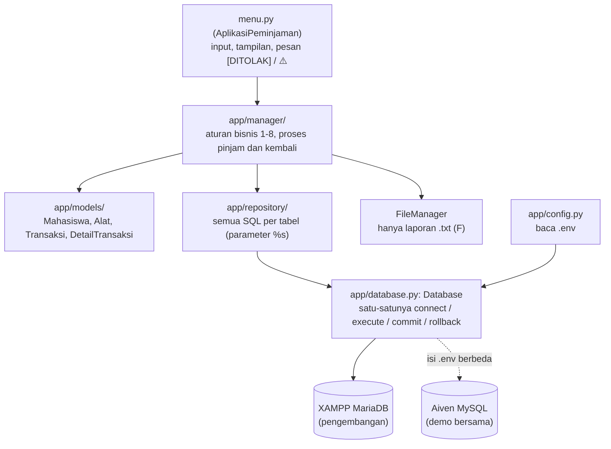
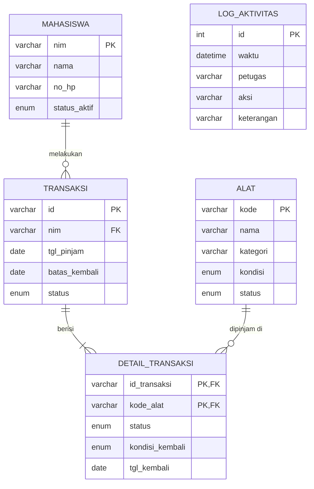
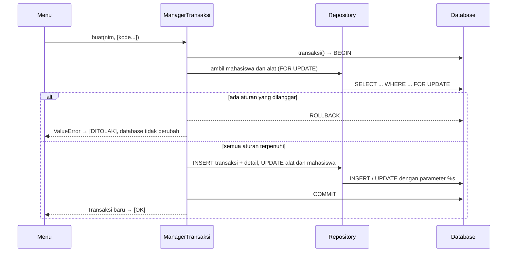
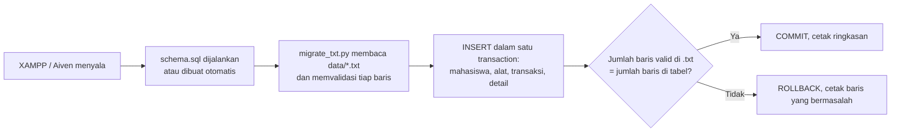

# MasterPlan: Migrasi ke MySQL (XAMPP) — Kelompok 2

Rencana kerja kelompok untuk memindahkan penyimpanan Sistem Peminjaman Peralatan Laboratorium dari text file (`.txt`)
ke MySQL sesuai panduan Proyek II yang baru. Aturan bisnis, menu, dan alur pinjam/kembali **tidak berubah**; yang
berubah adalah lapisan penyimpanan, beberapa artefak, dan skenario uji.

> **Status implementasi (19 November 2026):** bagian kelompok sudah dikerjakan: kode versi MySQL, `schema.sql`,
> `seed.sql`, `scripts/migrate_txt.py`, tes otomatis (60 tes), 10 skenario berskrip (`docs/bukti_eksekusi_skenario.md`),
> UML implementasi, ERD final, dan dokumen. Yang masih harus dikerjakan tim: artefak individu (UML + ERD tiap anggota),
> setup database online dan Skenario 8 dengan dua laptop, QA manual dengan tangkapan layar, isian bertanda `[ISI]`,
> cross-group code review, dan pembagian kontribusi di README.

| | |
|---|---|
| Tenggat | hari ini |
| Basis kode | versi final kemarin (setelah perbaikan code review, tantangan A, B, D, F) |
| Database pengembangan | XAMPP (MariaDB, kompatibel MySQL) di laptop masing-masing |
| Database bersama untuk demo | MySQL online gratis (Aiven for MySQL), dipakai untuk Skenario 8 dan 9 |
| Status dokumen | usulan; pembagian tugas dan jadwal dikonfirmasi tim di awal Blok 0 |

Daftar isi:
1. Ringkasan dan prioritas
2. Keputusan teknis
3. Arsitektur dan struktur repository
4. Desain database
5. Kontrak antarmuka (agar bisa dikerjakan paralel)
6. Setup lingkungan (XAMPP, Aiven, `.env`)
7. Migrasi data `.txt` ke MySQL
8. Jadwal hari ini, pembagian tugas, dan alur Git
9. Tahap 1: artefak individu
10. Pengujian (10 skenario)
11. Dokumen yang diperbarui
12. Checklist artefak yang dikumpulkan
13. Risiko dan mitigasi
14. Peran Claude
15. Lampiran: hasil uji draf skema dan perilaku koneksi

---

## 1. Ringkasan dan prioritas

Yang berubah dari versi `.txt`:

- data disimpan di tabel MySQL, bukan file; `data/*.txt` menjadi arsip dan dipindah sekali lewat `scripts/migrate_txt.py`;
- semua akses database lewat satu pintu (`Database`) dan repository per tabel; menu tidak menulis SQL;
- setiap query memakai parameter `%s`; operasi yang menyentuh beberapa tabel memakai transaction (`commit`/`rollback`);
- kredensial ada di `.env` (tidak di-commit), dengan contoh di `.env.example`;
- artefak baru: `database/schema.sql`, `database/seed.sql`, `scripts/migrate_txt.py`, `requirements.txt`, ERD;
- skenario uji menjadi 10, termasuk data antar-komputer (8), koneksi gagal (9), dan input duplikat/tanda kutip (10).

Prioritas bila waktu tidak cukup:

| Prioritas | Isi |
|---|---|
| **P0 (wajib)** | `schema.sql` + `seed.sql`; `Database` satu pintu dengan parameterized query, `try-except`, dan transaction; CRUD mahasiswa dan alat; pinjam dan kembali dalam transaction; menu 1–10 + 0; `.env.example`, `.gitignore`, `requirements.txt`; `migrate_txt.py`; 10 skenario diuji; README; UML final + ERD; keputusan desain; artefak individu; tantangan A dan B |
| **P1** | tantangan D (`log_aktivitas`), F (laporan `.txt`), G (keterlambatan); tes otomatis dengan database uji; paginasi `LIMIT` |
| **P2** | cross-group code review dan refleksi final (setelah sesi review) |

## 2. Keputusan teknis

| Hal | Keputusan | Alasan |
|---|---|---|
| Database pengembangan | XAMPP 8.2 (MariaDB 10.4) di laptop masing-masing | sesuai rencana kelompok, bisa dipakai tanpa internet |
| Database bersama | Aiven for MySQL (paket gratis) | memenuhi syarat "MySQL online" dan Skenario 8; kode sama, hanya isi `.env` yang berbeda |
| Library | `PyMySQL[rsa]` + `python-dotenv`, versi dikunci di `requirements.txt` | murni Python, cocok untuk MariaDB XAMPP dan MySQL 8 Aiven; `DictCursor` menghasilkan dict; `[rsa]` untuk login MySQL 8 tanpa kejutan |
| Tanpa ORM | SQL ditulis sendiri di repository | dilarang panduan |
| Mode koneksi | `autocommit=True`; penulisan beberapa tabel lewat `with db.transaksi():` | dengan `autocommit=False`, data yang baru disimpan anggota lain **tidak terlihat** sampai transaksi sendiri selesai (terbukti di Lampiran, uji 1), sehingga Skenario 8 gagal |
| Mode ketat | setiap koneksi menjalankan `SET SESSION sql_mode='STRICT_ALL_TABLES,...'` | tanpa mode ketat, nilai ENUM yang salah tersimpan sebagai teks kosong hanya dengan peringatan (Lampiran, uji 0); `sql_mode` XAMPP tidak selalu ketat |
| Konkurensi | baris alat dan mahasiswa yang dipakai dikunci dengan `SELECT ... FOR UPDATE` di dalam transaction | dua anggota yang meminjam alat yang sama bersamaan tidak bisa lolos keduanya (Lampiran, uji 2) |
| ID transaksi | tetap `T001`, `T002`, ...: nomor terbesar + 1 dibaca di dalam transaction; bila `INSERT` ditolak karena duplikat (1062), transaction diulang (maks. 3 kali) | format sama dengan data lama; aman bila dua komputer membuat transaksi bersamaan |
| `status_aktif` mahasiswa | tetap `aktif`/`tidak aktif` = status peminjaman, diatur otomatis | tafsiran yang sudah didokumentasikan; `aktif/nonaktif` di contoh panduan hanya contoh |
| Hapus data | dicek lebih dulu di program; FK `RESTRICT` (bawaan) sebagai pengaman | Aturan 6 dan 8; sama dengan keputusan sebelumnya (data yang punya riwayat tidak dapat dihapus) |
| Tantangan | A (cari `LIKE`), B (statistik `GROUP BY`/`COUNT`), D (tabel `log_aktivitas`), F (laporan `.txt`), G (transaksi terlambat) | A, B, D, F sudah ada, tinggal dipindah ke SQL; G murah karena keterlambatan sudah dihitung |
| Data lama | `data/` tetap di repo sebagai arsip, tidak dibaca program | panduan 3.4 |

## 3. Arsitektur dan struktur repository



Struktur repository target (BARU = file baru, UBAH = file lama diubah):

```text
main.py
requirements.txt                 BARU   PyMySQL[rsa], python-dotenv
.env.example                     BARU   contoh konfigurasi tanpa password
.gitignore                       UBAH   tambah *.pem (.env sudah ada)
app/
  config.py                      BARU   membaca .env menjadi dict konfigurasi
  database.py                    BARU   Database + DatabaseError
  repository/
    repo_mahasiswa.py            BARU
    repo_alat.py                 BARU
    repo_transaksi.py            BARU   transaksi + detail_transaksi
    repo_laporan.py              BARU   GROUP BY / COUNT (B), terlambat (G)
    repo_log.py                  BARU   log_aktivitas (D)
  manager/                       UBAH   memakai repository dan transaction; muat/simpan/_selaraskan dihapus
  models/                        UBAH   tambah dari_dict(); dari_baris() tetap untuk migrasi
  logger.py                      UBAH   menulis ke tabel log_aktivitas
  menu.py                        UBAH   pesan koneksi gagal, menu 14 (G), keluar = tutup koneksi
  file_manager.py                UBAH   dipersempit: laporan .txt dan pembacaan .txt lama saat migrasi
  validasi.py, konstanta.py      tetap (konstanta: tambah mode ketat dan nama tabel bila perlu)
database/
  schema.sql                     BARU   CREATE TABLE IF NOT EXISTS
  seed.sql                       BARU   5 mahasiswa, 10 alat, 3 transaksi
scripts/
  migrate_txt.py                 BARU   pindahkan data/*.txt ke MySQL (sekali jalan)
data/                            arsip .txt lama (tidak dibaca program)
tests/                           UBAH   tes tanpa DB tetap; tes berbasis file diganti tes dengan database uji
docs/                            UBAH   ERD, UML final, keputusan desain, pengujian, review, refleksi
```

Nama method publik manager **dipertahankan** (`tambah`, `edit`, `hapus`, `cari`, `semua`, `tersedia`, `buat`,
`kembalikan`, `statistik`, `ekspor_*`), sehingga `menu.py` hampir tidak berubah. Ini bukti desain "satu pintu I/O"
(panduan 3.4) dan bahan jawaban refleksi nomor 4.

Pemetaan aturan bisnis ke implementasi:

| Aturan | Diperiksa program lebih dulu (pesan ramah) | Pengaman di database |
|---|---|---|
| 1 Ketersediaan alat | status alat dibaca dengan `FOR UPDATE` di dalam transaction | ENUM `status` |
| 2 Batas peminjaman | `COUNT` transaksi aktif milik NIM (baris mahasiswa dikunci) | - |
| 3 Isi transaksi | list `DetailTransaksi`, satu `INSERT` per alat dalam satu transaction | PK `(id_transaksi, kode_alat)` mencegah alat dobel |
| 4 Pengembalian sebagian | status transaksi dihitung dari detail (`Transaksi.perbarui_status`) | ENUM `status`, CHECK detail |
| 5 Kondisi alat | `Alat.status_dari_kondisi` (baik = tersedia, lainnya = tidak tersedia) | ENUM `kondisi` |
| 6 Penghapusan data | cek transaksi aktif dan riwayat sebelum `DELETE` | FK `RESTRICT` (kode 1451) |
| 7 Konsistensi | semua aturan dicek sebelum menulis; transaction | `COMMIT` atau `ROLLBACK` utuh |
| 8 Keterkaitan | cek NIM/kode ada dan tidak ganda sebelum `INSERT` | PK, FK, NOT NULL, CHECK |

## 4. Desain database



Draf `database/schema.sql` (sudah diuji di MariaDB, lihat Lampiran). Draf ini **difinalkan saat diskusi kelompok
(Blok 2)** setelah setiap anggota membuat rancangan tabel sendiri. Panjang kolom mengikuti `app/validasi.py`.

```sql
CREATE TABLE IF NOT EXISTS mahasiswa (
    nim          VARCHAR(20) NOT NULL,
    nama         VARCHAR(60) NOT NULL,
    no_hp        VARCHAR(16) NULL,
    status_aktif ENUM('aktif','tidak aktif') NOT NULL DEFAULT 'tidak aktif',
    PRIMARY KEY (nim)
) ENGINE=InnoDB DEFAULT CHARSET=utf8mb4;

CREATE TABLE IF NOT EXISTS alat (
    kode     VARCHAR(15) NOT NULL,
    nama     VARCHAR(60) NOT NULL,
    kategori VARCHAR(40) NOT NULL,
    kondisi  ENUM('baik','rusak ringan','rusak berat') NOT NULL DEFAULT 'baik',
    status   ENUM('tersedia','dipinjam','tidak tersedia') NOT NULL DEFAULT 'tersedia',
    PRIMARY KEY (kode),
    INDEX idx_alat_status (status),
    INDEX idx_alat_kategori (kategori)
) ENGINE=InnoDB DEFAULT CHARSET=utf8mb4;

CREATE TABLE IF NOT EXISTS transaksi (
    id            VARCHAR(20) NOT NULL,
    nim           VARCHAR(20) NOT NULL,
    tgl_pinjam    DATE NOT NULL,
    batas_kembali DATE NOT NULL,
    status        ENUM('dipinjam','sebagian dikembalikan','selesai') NOT NULL DEFAULT 'dipinjam',
    PRIMARY KEY (id),
    INDEX idx_transaksi_nim_status (nim, status),
    CONSTRAINT fk_transaksi_mahasiswa FOREIGN KEY (nim) REFERENCES mahasiswa (nim),
    CONSTRAINT chk_transaksi_batas CHECK (batas_kembali >= tgl_pinjam)
) ENGINE=InnoDB DEFAULT CHARSET=utf8mb4;

CREATE TABLE IF NOT EXISTS detail_transaksi (
    id_transaksi    VARCHAR(20) NOT NULL,
    kode_alat       VARCHAR(15) NOT NULL,
    status          ENUM('dipinjam','dikembalikan') NOT NULL DEFAULT 'dipinjam',
    kondisi_kembali ENUM('baik','rusak ringan','rusak berat') NULL,
    tgl_kembali     DATE NULL,
    PRIMARY KEY (id_transaksi, kode_alat),
    INDEX idx_detail_alat (kode_alat, status),
    CONSTRAINT fk_detail_transaksi FOREIGN KEY (id_transaksi) REFERENCES transaksi (id),
    CONSTRAINT fk_detail_alat FOREIGN KEY (kode_alat) REFERENCES alat (kode),
    CONSTRAINT chk_detail_kembali CHECK (
        (status = 'dipinjam' AND kondisi_kembali IS NULL AND tgl_kembali IS NULL)
        OR (status = 'dikembalikan' AND kondisi_kembali IS NOT NULL AND tgl_kembali IS NOT NULL))
) ENGINE=InnoDB DEFAULT CHARSET=utf8mb4;

CREATE TABLE IF NOT EXISTS log_aktivitas (
    id         INT NOT NULL AUTO_INCREMENT,
    waktu      DATETIME NOT NULL DEFAULT CURRENT_TIMESTAMP,
    petugas    VARCHAR(50) NOT NULL,
    aksi       VARCHAR(30) NOT NULL,
    keterangan VARCHAR(255) NOT NULL,
    PRIMARY KEY (id),
    INDEX idx_log_waktu (waktu)
) ENGINE=InnoDB DEFAULT CHARSET=utf8mb4;
```

Alasan desain yang perlu ditulis di dokumen keputusan desain:

- **ID tetap `VARCHAR`** (`M001`, `A001`, `T001`) agar sama dengan data lama dan mudah dibaca petugas.
- **ENUM** untuk status dan kondisi: nilai di luar daftar ditolak database (dengan mode ketat).
- **`NULL`** menggantikan tanda `-` pada versi `.txt` (kondisi dan tanggal kembali yang belum ada, no. HP kosong).
- **CHECK** menjaga dua aturan yang dulu dicek saat memuat file: batas kembali tidak sebelum tanggal pinjam, dan detail
  yang masih dipinjam tidak boleh punya kondisi/tanggal kembali (sebaliknya untuk yang sudah kembali).
- **Indeks** untuk query yang sering dipakai: alat per status/kategori, transaksi aktif per NIM, riwayat per alat.
  FK pada InnoDB memerlukan indeks dan indeks ini sekaligus memenuhinya.
- **`log_aktivitas`** berdiri sendiri (tanpa FK) agar log tetap tercatat walaupun data yang dirujuk dihapus.

`database/seed.sql` berisi data yang sama dengan `data_sampel/` (5 mahasiswa, 10 alat, 3 transaksi, 5 detail), diisi
berurutan tabel induk (`mahasiswa`, `alat`) lalu anak (`transaksi`, `detail_transaksi`), dengan `-` menjadi `NULL`.
Contoh dua baris pertama tiap tabel:

```sql
INSERT INTO mahasiswa VALUES ('M001','Andi Pratama','081234567890','aktif'), ('M005','Eko Prasetyo',NULL,'tidak aktif');
INSERT INTO alat VALUES ('A001','Multimeter Digital','pengukuran','baik','dipinjam'), ('A004','Breadboard','prototyping','rusak ringan','tidak tersedia');
INSERT INTO transaksi VALUES ('T001','M001','2026-11-02','2026-11-09','dipinjam'), ('T003','M003','2026-11-03','2026-11-10','sebagian dikembalikan');
INSERT INTO detail_transaksi VALUES ('T001','A001','dipinjam',NULL,NULL), ('T003','A004','dikembalikan','rusak ringan','2026-11-05');
```

## 5. Kontrak antarmuka (agar bisa dikerjakan paralel)

Kontrak ini dibuat **pertama kali oleh Arif (Blok 3)** dan langsung di-merge, supaya anggota lain dapat menulis
repository dan manager tanpa menunggu.

### 5.1 `app/database.py`

| Method | Keterangan |
|---|---|
| `Database(konfigurasi)` | konfigurasi dari `app/config.py` (`host`, `port`, `user`, `password`, `database`, `ssl_ca`) |
| `sambung()` | `pymysql.connect(..., cursorclass=DictCursor, autocommit=True, connect_timeout=5, charset='utf8mb4', init_command=<mode ketat>)`; SSL dipakai bila `DB_SSL_CA` diisi |
| `pastikan_tabel(path_schema)` | bila database belum ada (1049) dan hak akses cukup, buat dulu; lalu jalankan setiap pernyataan `CREATE TABLE IF NOT EXISTS` di `schema.sql` |
| `query(sql, parameter=())` | `list[dict]` |
| `query_satu(sql, parameter=())` | `dict` atau `None` |
| `eksekusi(sql, parameter=())` | jumlah baris yang berubah |
| `transaksi()` | context manager: `BEGIN`, lalu `COMMIT` bila blok selesai tanpa error, atau `ROLLBACK` lalu error dilempar ulang |
| `tutup()` | menutup koneksi (menu 0) |

Semua error PyMySQL dibungkus menjadi `DatabaseError` dengan pesan ramah:

| Kode MySQL | Arti | Pesan untuk pengguna (contoh) |
|---|---|---|
| 2003, 2006, 2013 | server tidak terjangkau / koneksi putus | Tidak dapat terhubung ke database. Pastikan MySQL di XAMPP menyala (atau internet tersambung untuk Aiven) dan `DB_HOST`/`DB_PORT` di `.env` benar. |
| 1045 | login ditolak | Login database ditolak. Periksa `DB_USER` dan `DB_PASSWORD` di `.env`. |
| 1049 | database belum ada | Database belum ada. Buat lewat phpMyAdmin atau jalankan `database/schema.sql`. |
| 1062 | duplikat | Data dengan kunci tersebut sudah ada. |
| 1451 | masih dirujuk | Data masih tercatat di transaksi, tidak dapat dihapus. |
| 1452 | rujukan tidak ada | NIM atau kode alat yang dirujuk tidak ditemukan. |
| 1205 | menunggu kunci terlalu lama | Data sedang diproses anggota lain. Coba lagi. |
| 1265, 1364, 3819, 4025 | nilai melanggar aturan tabel | Nilai tidak sesuai aturan tabel. |

Pola penulisan beberapa tabel (contoh pembuatan transaksi):

```python
with self.db.transaksi():
    mahasiswa = self.repo_mahasiswa.ambil(nim, kunci=True)          # SELECT ... FOR UPDATE
    if mahasiswa is None: raise ValueError('Mahasiswa ... tidak ditemukan.')
    if self.repo_mahasiswa.jumlah_transaksi_aktif(nim) >= MAKS_TRANSAKSI_AKTIF: raise ValueError('...')
    for kode in daftar_kode:
        alat = self.repo_alat.ambil(kode, kunci=True)                # SELECT ... FOR UPDATE
        if alat is None or alat.status != STATUS_TERSEDIA: raise ValueError('...')
    transaksi = Transaksi(self.repo_transaksi.id_baru(), nim, hari_ini, batas)
    self.repo_transaksi.tambah(transaksi, daftar_kode)               # INSERT header + detail
    for kode in daftar_kode: self.repo_alat.set_status(kode, STATUS_DIPINJAM)
    self.repo_mahasiswa.set_status_aktif(nim, MHS_AKTIF)
# keluar blok tanpa error -> COMMIT; ValueError atau DatabaseError -> ROLLBACK, database tidak berubah (Aturan 7)
```



### 5.2 Repository (semua SQL ada di sini, selalu dengan parameter `%s`)

| Class | Method |
|---|---|
| `RepoMahasiswa` | `ambil(nim, kunci=False)`, `semua(batas, mulai)`, `cari(kata)`, `tambah(mhs)`, `ubah(mhs)`, `hapus(nim)`, `jumlah_transaksi_aktif(nim)`, `punya_riwayat(nim)`, `set_status_aktif(nim, status)` |
| `RepoAlat` | `ambil(kode, kunci=False)`, `semua(batas, mulai)`, `cari(kata)` (`LIKE` pada kode, nama, kategori), `per_status(status)`, `rusak()`, `daftar_kategori()`, `tambah(alat)`, `ubah(alat)`, `hapus(kode)`, `punya_riwayat(kode)`, `dalam_transaksi_aktif(kode)`, `set_status(kode, status, kondisi=None)` |
| `RepoTransaksi` | `ambil(id)` (header + detail), `semua(batas, mulai)`, `aktif_milik(nim)`, `riwayat(nim)`, `id_baru()`, `tambah(transaksi, daftar_kode)`, `kembalikan_detail(id, kode, kondisi, tanggal)`, `set_status(id, status)` |
| `RepoLaporan` | `alat_terbanyak(n)`, `mahasiswa_terbanyak(n)`, `jumlah_per_status()`, `terlambat(tanggal)` |
| `RepoLog` | `catat(petugas, aksi, keterangan)`, `terakhir(n)` |

Ketentuan penulisan SQL:

- **dilarang** menyusun SQL dengan f-string, `%` pada string SQL, atau `+` dari input pengguna; nilai selalu lewat parameter;
- daftar dan pencarian difilter di database (`WHERE`, `JOIN`, `COUNT`, `LIMIT`), bukan memuat seluruh tabel lalu disaring di Python;
- pencarian `LIKE` meng-escape `%`, `_`, dan `\` dari kata kunci sebelum dibungkus `%...%`;
- repository mengubah baris hasil query (dict) menjadi objek model lewat `Model.dari_dict(baris)`.

### 5.3 Perubahan per modul lama

| Modul | Perubahan |
|---|---|
| `manager_mahasiswa.py`, `manager_alat.py`, `manager_dasar.py` | dictionary seluruh data dan `muat`/`simpan` dihapus; setiap method memanggil repository; validasi input tetap memakai `validasi.py`; `ManagerDasar` tetap menjadi dasar bersama untuk `ambil`/`ada`/`cari` |
| `manager_transaksi.py` | `buat()` memakai pola 5.1; `simpan_semua`, `_selaraskan`, dan logika baris karantina dihapus karena transaction menjaga konsistensi |
| `manager_pengembalian.py` | `kembalikan()` mengubah detail, alat, transaksi, dan status mahasiswa dalam satu transaction; pemulihan manual kondisi alat tidak diperlukan lagi (diganti `ROLLBACK`) |
| `manager_laporan.py` | statistik dari `RepoLaporan` (`GROUP BY`); ekspor laporan `.txt` tetap lewat `FileManager.tulis_teks` |
| `logger.py` | `catat()` menulis ke `log_aktivitas` dengan nama petugas dari `.env` (`NAMA_PETUGAS`); kegagalan log hanya diperingatkan |
| `menu.py` | `siapkan()`: baca konfigurasi, `sambung()`, `pastikan_tabel()`; `DatabaseError` ditampilkan sebagai ⚠️ tanpa crash; menu 14 "Tampilkan transaksi terlambat" (G); menu 0 menutup koneksi |
| `models/*.py` | tambah `dari_dict()`; tanggal dari database diubah ke teks `YYYY-MM-DD`, `NULL` ditampilkan sebagai `-` |
| `file_manager.py` | fungsi karantina baris rusak tidak dipakai program lagi (dipakai `migrate_txt.py` untuk melaporkan baris yang ditolak) |

## 6. Setup lingkungan

### 6.1 XAMPP (setiap anggota)

1. Pasang XAMPP 8.2, buka **XAMPP Control Panel**, klik **Start** pada **MySQL** (dan Apache bila ingin memakai phpMyAdmin).
2. Buka `http://localhost/phpmyadmin`, buat database `peminjaman_lab` dengan collation `utf8mb4_general_ci`.
   (Program juga dapat membuatnya sendiri bila user memiliki hak akses, misalnya `root` XAMPP.)
3. Jalankan `database/schema.sql` lalu `database/seed.sql` lewat tab **Import** di phpMyAdmin, atau biarkan program
   membuat tabel otomatis lalu isi data dengan `migrate_txt.py` (bagian 7).
4. Di folder proyek: `py -m pip install -r requirements.txt` (Windows) atau `python3 -m pip install -r requirements.txt`.
5. Salin `.env.example` menjadi `.env`, lalu sesuaikan isinya. Isi untuk XAMPP bawaan:

```text
DB_HOST=127.0.0.1
DB_PORT=3306
DB_USER=root
DB_PASSWORD=
DB_NAME=peminjaman_lab
DB_SSL_CA=
NAMA_PETUGAS=Nama Anggota
```

6. Jalankan `python main.py`.

Isi `requirements.txt`:

```text
PyMySQL[rsa]==1.1.1
python-dotenv==1.0.1
```

### 6.2 Aiven for MySQL (dibuat satu anggota, untuk demo bersama)

1. Daftar di console Aiven, buat service **MySQL** dengan paket **Free**, tunggu status **Running**.
2. Catat host, port, user (`avnadmin`), password, dan nama database (`defaultdb`, atau buat `peminjaman_lab` di tab
   **Databases**). Unduh **CA certificate** (`ca.pem`).
3. Bagikan isi `.env` dan `ca.pem` ke anggota lain **lewat chat pribadi**, bukan lewat repo.
4. Di laptop masing-masing, buat `.env` untuk Aiven (simpan `.env` XAMPP dengan nama lain, misalnya `.env.xampp`):

```text
DB_HOST=<host dari Aiven>
DB_PORT=<port dari Aiven>
DB_USER=avnadmin
DB_PASSWORD=<password dari Aiven>
DB_NAME=defaultdb
DB_SSL_CA=C:/path/ke/ca.pem
NAMA_PETUGAS=Nama Anggota
```

5. Jalankan program sekali (tabel dibuat otomatis), lalu isi data contoh dengan `python scripts/migrate_txt.py --sumber data_sampel`.
6. Layanan gratis Aiven dapat mati otomatis bila lama tidak dipakai; nyalakan lagi dari console sebelum demo.

### 6.3 Keamanan kredensial

- `.env` sudah ada di `.gitignore`; tambahkan `*.pem`.
- Sebelum setiap commit: `git status` dan pastikan `.env` serta `ca.pem` tidak muncul.
- Password tidak boleh ditulis di kode, README, dokumen, maupun pesan commit.

## 7. Migrasi data `.txt` ke MySQL



- Baris dibaca dengan `FileManager.baca_baris` dan divalidasi dengan `dari_baris()` model yang sudah ada.
- Baris tidak valid (dan isi `data/baris_rusak.txt` bila ada) tidak dimigrasikan; daftarnya dicetak agar dapat diperbaiki.
- Script menolak berjalan bila tabel sudah berisi data, kecuali diberi opsi `--kosongkan` (menghapus data anak dulu, lalu induk).
- Opsi `--sumber data_sampel` dipakai untuk mengisi data contoh di Aiven.
- Script disimpan di `scripts/` sebagai dokumentasi dan bahan presentasi.

## 8. Jadwal hari ini, pembagian tugas, dan alur Git

### 8.1 Jadwal

Contoh bila mulai pukul 08.00 (geser sesuai jam mulai). Total sekitar 8 jam termasuk jeda.

| Blok | Waktu | Kegiatan | Hasil |
|---|---|---|---|
| 0 | 08.00–08.30 | Konfirmasi MasterPlan dan pembagian tugas. Arif menerapkan versi final kemarin (`CARA_PAKAI.md`) lalu push; semua anggota `git pull`, memasang XAMPP, dan menyalakan MySQL. Arif mendaftar Aiven (paralel) | basis kode sama, XAMPP menyala |
| 1 | 08.30–09.30 | **Tahap 1 individu, dikerjakan sendiri-sendiri** (bagian 9): UML draw.io + ERD/rancangan tabel | 4 UML + 4 ERD individu |
| 2 | 09.30–10.00 | Diskusi: bandingkan rancangan, pilih atau gabung → ERD final, `schema.sql` final, sketsa UML final, catatan keputusan desain | artefak Tahap 1 kelompok |
| 3 | 10.00–10.45 | Arif: `config.py`, `database.py`, `.env.example`, `requirements.txt` → merge duluan. Fatimah + Faris: `schema.sql`, `seed.sql`. Niken: database uji dan daftar periksa 10 skenario | fondasi siap |
| 4 | 10.45–13.15 (termasuk istirahat) | Implementasi paralel di branch masing-masing (8.2), PR ke `main` | fitur lengkap |
| 5 | 13.15–14.15 | Merge semua PR, `migrate_txt.py`, uji skenario 1–7, 9, 10 di XAMPP | bukti uji XAMPP |
| 6 | 14.15–14.45 | Demo dengan Aiven: Skenario 8 (dua laptop) dan Skenario 9 | bukti data bersama |
| 7 | 14.45–15.45 | Dokumen (bagian 11), cek akhir (`.env`, `ca.pem` tidak ter-commit), push | siap dikumpulkan |

### 8.2 Pembagian tugas (usulan, mengikuti peran sebelumnya)

| Anggota | Akun GitHub | Tanggung jawab utama | File utama |
|---|---|---|---|
| Muhammad Nur Arif | ariftronic | koneksi dan konfigurasi, menu, log aktivitas (D), setup Aiven, README bagian setup | `config.py`, `database.py`, `.env.example`, `requirements.txt`, `menu.py`, `logger.py`, `repo_log.py` |
| Fatimah Az Zahra | fatimahzahrara | skema mahasiswa dan alat, data contoh, CRUD + pencarian `LIKE` (A), ERD dan UML final | `repo_mahasiswa.py`, `repo_alat.py`, `manager_mahasiswa.py`, `manager_alat.py`, `seed.sql` |
| Faris Rafiuddin Hannan | farisrafiuddin82-oss | skema transaksi, peminjaman dengan transaction, migrasi | `repo_transaksi.py`, `manager_transaksi.py`, `scripts/migrate_txt.py` |
| Niken Syafira Zulfarida | Niken5yafiraZulfarida | pengembalian dengan transaction, keterlambatan (G), statistik dan laporan (B, F), QA 10 skenario | `manager_pengembalian.py`, `manager_laporan.py`, `repo_laporan.py`, tes, `docs/pengujian.md` |

Dokumen kelompok: keputusan desain (Arif), ERD dan UML final (Fatimah), pengujian (Niken), refleksi (Niken), kontrak
antarmodul (Faris), cross-group review (semua, satu aspek per anggota).

### 8.3 Alur Git

- Setiap anggota memakai akun GitHub sendiri dan branch sendiri: `db/arif-koneksi`, `db/fatimah-mahasiswa-alat`,
  `db/faris-transaksi`, `db/niken-pengembalian`.
- Urutan merge: Arif (koneksi) → Fatimah (mahasiswa/alat) → Faris (transaksi) → Niken (pengembalian, laporan, tes).
- Setiap PR direview satu anggota lain sebelum di-merge (review juga dihitung sebagai kontribusi).
- Commit kecil dengan pesan yang jelas; jangan menggabungkan pekerjaan beberapa anggota ke satu akun.

## 9. Tahap 1: artefak individu

Dikerjakan **sendiri oleh setiap anggota** sebelum diskusi (Blok 1). Claude hanya memberi pertanyaan pemandu dan
mereview, tidak membuatkan.

Isi yang wajib ada (panduan 8.1):

- [ ] UML Class Diagram di draw.io: class, atribut, method utama, hubungan, tanggung jawab, serta class/method yang mengakses database;
- [ ] ERD dan rancangan tabel: nama tabel, kolom dan tipe data, PK/FK, **minimal 2 baris contoh per tabel**, kapan query dan kapan commit;
- [ ] disimpan sebagai `docs/individu/UML_DB_<Nama>.drawio` + `.png` dan `docs/individu/ERD_<Nama>.png` + `Rancangan_Tabel_<Nama>.md`.

Pertanyaan pemandu yang harus terjawab di rancangan masing-masing:

1. Class mana yang satu-satunya membuka koneksi dan menjalankan SQL? Mengapa menu tidak boleh menulis SQL?
2. Kolom apa yang menjadi PK di tiap tabel, dan FK mana yang merujuk ke tabel lain?
3. Mengapa tipe data tiap kolom dipilih (misalnya `VARCHAR` vs `INT` untuk ID, `ENUM` vs `VARCHAR` untuk status)?
4. Saat meminjam dan mengembalikan alat, tabel apa saja yang berubah, dan di mana `commit`/`rollback` terjadi?
5. Bagaimana mencegah SQL injection pada input nama atau kata kunci pencarian?
6. Query mana yang memakai `WHERE`/`JOIN`/`COUNT` agar tidak memuat seluruh tabel?
7. Apa yang ditampilkan program bila koneksi gagal atau password salah?

## 10. Pengujian (10 skenario)

| No | Skenario | Cara uji | Database | Bukti | Penanggung jawab |
|---|---|---|---|---|---|
| 1 | Tambah beberapa mahasiswa dan alat | menu 1 dan 2 | XAMPP | layar + `SELECT * FROM mahasiswa/alat` | Fatimah |
| 2 | Satu mahasiswa meminjam beberapa alat dalam satu transaksi | menu 3 | XAMPP | layar + isi `transaksi`, `detail_transaksi`, `alat` | Faris |
| 3 | Meminjam alat yang tidak tersedia | menu 3 dengan alat berstatus `dipinjam`/`tidak tersedia` | XAMPP | pesan `[DITOLAK]` + `SELECT COUNT(*)` sebelum dan sesudah sama | Faris |
| 4 | Mengembalikan sebagian alat | menu 5 | XAMPP | status alat, status transaksi `sebagian dikembalikan`, alat yang masih dipinjam | Niken |
| 5 | Alat kembali rusak ringan/berat | menu 5 | XAMPP | alat `tidak tersedia`, muncul di menu 9 | Niken |
| 6 | Menghapus mahasiswa yang punya transaksi aktif | menu 1 > hapus | XAMPP | pesan `[DITOLAK]`, data tetap | Fatimah |
| 7 | Tutup lalu jalankan ulang program | menu 0, lalu `python main.py` | XAMPP | semua data dan status (termasuk sebagian dikembalikan) sama | Niken |
| 8 | Anggota A menambah data, anggota B melihatnya di komputer lain | dua laptop dengan `.env` Aiven | Aiven | layar kedua laptop | Arif + satu anggota |
| 9 | Internet mati / password salah di `.env` | matikan Wi-Fi atau ubah `DB_PASSWORD`; juga Stop MySQL di XAMPP | Aiven + XAMPP | pesan ⚠️, program tidak crash | Arif |
| 10 | NIM yang sudah ada / input berisi tanda kutip `'` | tambah `M001` lagi; nama `Siti O'Neil` | XAMPP | pesan ramah, nama tersimpan utuh, tidak ada error SQL mentah | Fatimah |

Tes otomatis (P1):

- tes tanpa database (validasi, model, format laporan) tetap dipakai;
- tes repository, aturan bisnis, dan menu memakai database uji `peminjaman_lab_test` yang tabelnya dibuat ulang untuk
  setiap kelas tes; bila database uji tidak tersedia, tes dilewati dengan pesan yang jelas;
- tes berbasis file `.txt` (`test_file_manager.py` bagian data, `test_integrasi.py`, `test_perbaikan_review.py`) diganti;
- `tests/skenario_wajib.py` diganti versi 10 skenario yang menjalankan `main.py` terhadap database uji
  (Skenario 8 tetap dilakukan manual dengan dua laptop).

## 11. Dokumen yang diperbarui

| Dokumen | Isi yang ditambahkan | Penanggung jawab |
|---|---|---|
| `README.md` | skema tabel dan relasi (ERD), cara setup XAMPP/Aiven dan `.env`, cara migrasi, cara menjalankan, pembagian kontribusi tahap MySQL | Arif |
| `docs/final/` | ERD final, UML final (dengan `Database` dan repository), `schema.sql` final | Fatimah |
| `docs/keputusan_desain.md` | bagian baru: rancangan dasar tahap MySQL dan bagian yang diambil dari anggota lain **[ISI setelah diskusi Blok 2]**, alasan desain tabel/tipe data/constraint, alasan memilih XAMPP + Aiven, alternatif (database LAN, TiDB, ORM dan SQLite yang dilarang) | Arif |
| `docs/kontrak_antarmodul.md` | kontrak `Database` dan repository (bagian 5) | Faris |
| `docs/pengujian.md` | 10 skenario dengan bukti dan hasil **[ISI hasil uji]** | Niken |
| `docs/cross_group_review.md` | aspek 3 diganti "Pengelolaan database" (satu pintu, parameterized query, transaction + rollback, koneksi gagal, PK/FK, password tidak bocor) dan aspek 4 (query terfilter, indeks) **[ISI setelah review]** | semua |
| `docs/refleksi.md` | pertanyaan baru nomor 4 (berapa banyak kode yang berubah saat migrasi), 5 (desain tabel dan constraint), 6 (database online vs text file) **[ISI setelah review]** | Niken |

## 12. Checklist artefak yang dikumpulkan

| Artefak (panduan 10.1) | Lokasi | Penanggung jawab | Prioritas | Status |
|---|---|---|---|---|
| UML Class Diagram tiap anggota | `docs/individu/UML_DB_<Nama>` | masing-masing | P0 | ☐ |
| Rancangan tabel / ERD tiap anggota | `docs/individu/ERD_<Nama>`, `Rancangan_Tabel_<Nama>.md` | masing-masing | P0 | ☐ |
| UML Class Diagram final | `docs/final/` | Fatimah | P0 | ☐ |
| ERD + `schema.sql` final | `docs/final/`, `database/schema.sql` | Fatimah + Faris | P0 | ☐ |
| Dokumen keputusan desain | `docs/keputusan_desain.md` | Arif | P0 | ☐ |
| URL repository GitHub | README | Arif | P0 | ☐ |
| Source code program | `app/`, `main.py` | semua | P0 | ☐ |
| Script migrasi `.txt` ke MySQL | `scripts/migrate_txt.py` | Faris | P0 | ☐ |
| Data contoh (5 mahasiswa, 10 alat, 3 transaksi) | `database/seed.sql` | Fatimah | P0 | ☐ |
| README (termasuk setup database) | `README.md` | Arif | P0 | ☐ |
| Dokumen hasil pengujian (10 skenario) | `docs/pengujian.md` | Niken | P0 | ☐ |
| Dokumen hasil cross-group code review | `docs/cross_group_review.md` | semua | P2 | ☐ |
| Dokumen refleksi dan rencana perbaikan | `docs/refleksi.md` | Niken | P2 | ☐ |

Pemeriksaan aturan "dilarang" sebelum dikumpulkan:

- [ ] tidak ada data utama di `.txt`/`json`/`csv`/`pickle`/`shelve` (laporan `.txt` boleh);
- [ ] tidak ada SQL yang disusun dengan f-string, `%`, atau `+` dari input (`grep -rn "execute(f" app`);
- [ ] tidak ada host, user, atau password di kode dan di riwayat commit;
- [ ] tidak ada ORM; semua SQL hanya di `app/repository/` dan `app/database.py`;
- [ ] tidak ada variabel terpisah per alat;
- [ ] setiap anggota punya commit dari akunnya sendiri.

## 13. Risiko dan mitigasi

| Risiko | Mitigasi |
|---|---|
| MySQL XAMPP tidak mau start karena port 3306 dipakai program lain | ubah `port` di `xampp/mysql/bin/my.ini`, samakan `DB_PORT` |
| Perbedaan MariaDB (XAMPP) dan MySQL 8 (Aiven) | pakai SQL standar seperti di draf; uji skenario utama di keduanya |
| Nilai salah tersimpan diam-diam karena `sql_mode` tidak ketat | mode ketat dipasang di setiap koneksi (bagian 2) |
| Anggota lain tidak melihat data baru (snapshot basi) | `autocommit=True` untuk baca, transaction hanya untuk tulis |
| Aiven menolak koneksi tanpa SSL atau layanan sedang mati | isi `DB_SSL_CA`; nyalakan layanan sebelum demo |
| Password bocor ke GitHub | `.env` dan `*.pem` di `.gitignore`; cek `git status`; bila terlanjur, ganti password di Aiven |
| Dua anggota mengubah file yang sama | kontrak bagian 5 dibuat duluan; satu file utama satu penanggung jawab |
| Waktu tidak cukup | kerjakan P0 dulu; P1 dan P2 menyusul |

## 14. Peran Claude

Sesuai panduan bagian 11:

- **Artefak individu** (UML dan rancangan tabel): hanya pertanyaan pemandu dan review, tidak membuatkan.
- **Implementasi kelompok**: kode per bagian (satu class/fungsi) beserta penjelasan dan contoh uji, saat diminta.
- **Review**: urutan temuan pelanggaran aturan dan keamanan, bug, desain/skalabilitas, lalu gaya kode.
- **Dokumen**: kerangka dari informasi kelompok dengan penanda `[ISI]` untuk hal yang hanya diketahui tim; tidak mengarang.

## 15. Lampiran: hasil uji draf skema dan perilaku koneksi

Diuji pada 19 November 2026 dengan MariaDB 10.11 (XAMPP memakai MariaDB 10.4; fitur yang dipakai sudah ada sejak 10.2)
dan PyMySQL 1.1.1.

| No | Uji | Hasil |
|---|---|---|
| 0 | `schema.sql` dijalankan dua kali, lalu data contoh | aman diulang; 5 mahasiswa, 10 alat, 3 transaksi, 5 detail masuk |
| 0 | data salah | duplikat PK ditolak (1062); FK tidak ada (1452); hapus mahasiswa/alat yang punya riwayat (1451); batas sebelum pinjam dan detail tidak konsisten (4025); ENUM salah (1265); kolom wajib kosong (1364). Tanpa mode ketat, ENUM salah **tersimpan sebagai teks kosong** dengan peringatan saja |
| 1 | data yang baru disimpan koneksi A dibaca koneksi B | `autocommit=False`: **tidak terlihat**; `autocommit=True`: langsung terlihat |
| 2 | dua koneksi mengunci alat yang sama (`FOR UPDATE`) | koneksi kedua menunggu, lalu ditolak dengan 1205 setelah batas waktu |
| 3 | `INSERT` detail gagal di tengah transaction | `ROLLBACK`; jumlah transaksi tetap |
| 4 | nama `Siti O'Neil` dan `x'); DROP TABLE mahasiswa; --` lewat parameter `%s` | tersimpan apa adanya; tabel tetap ada |
| 5 | pencarian `LIKE` "ukur" | menemukan alat berkategori `pengukuran` |
| 6 | `GROUP BY`/`COUNT` dan transaksi terlambat | statistik dan daftar terlambat benar |
| 7 | koneksi gagal | password salah 1045, server mati/port salah 2003, database belum ada 1049 |
| 8 | database belum ada lalu `pastikan_tabel` | database dan lima tabel dibuat otomatis; tabel kosong tidak menimbulkan error |
